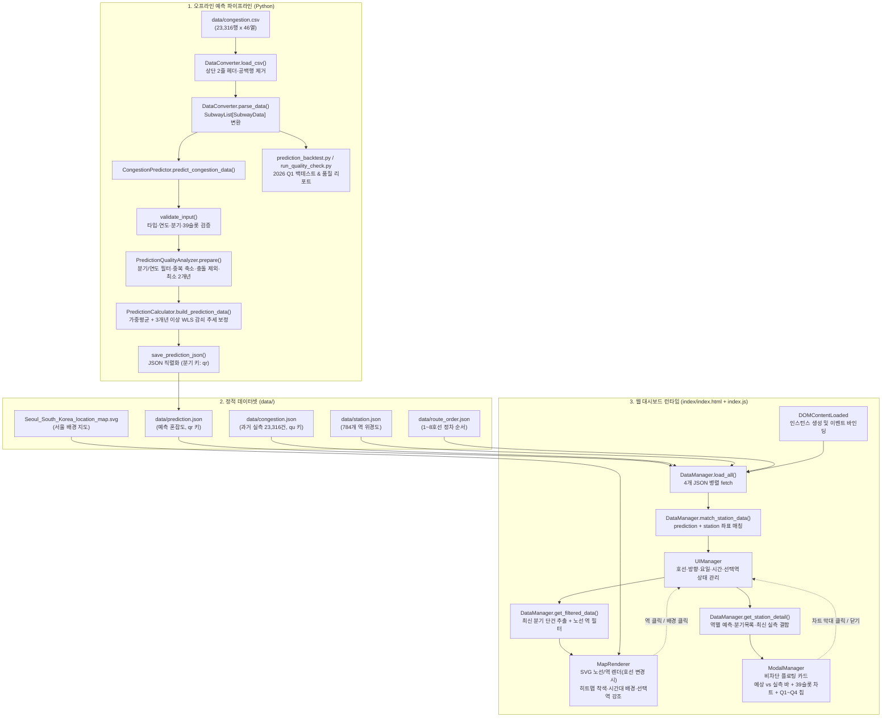
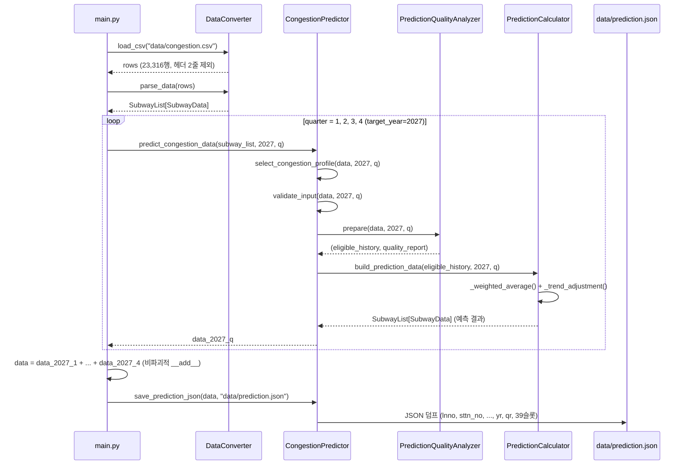
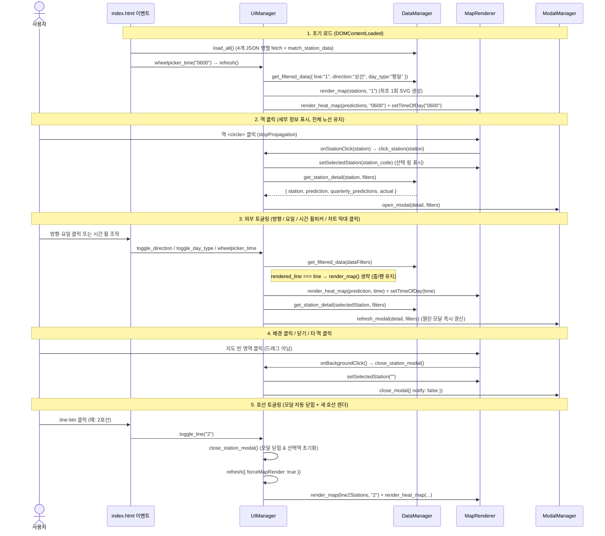

# Subway Congestion Info — 최종 시스템 아키텍처 · 데이터 · 메서드 플로우 분석 (`FINAL.md`)

> **분석 기준 커밋**: `main` (`2a3e135`, PR #1 ~ #4 전체 병합 완료)  
> **백엔드 자동화 테스트**: `python3 -m unittest discover -s tests` — **20/20 통과**  
> **백테스트 성능 (2026 Q1)**: 비교 프로필 1,641개 / 62,905 슬롯, **MAE `2.2422`** (직전 연도 베이스라인 `2.3855` 대비 개선)

---

## 1. 프로젝트 개요 및 전체 파일 구조

**Subway Congestion Info**는 서울교통공사 지하철 혼잡도 원천 데이터(`CSV`)를 정제·검증하여 미래 분기별 혼잡도를 예측하는 **오프라인 Python 백엔드 파이프라인**과, 생성된 예측 데이터 및 과거 실측 데이터를 서울 지도 위 SVG 노선도 히트맵·상세 모달로 시각화하는 **Vanilla HTML/CSS/JS 프론트엔드 대시보드**로 구성되어 있습니다.

### 1.1 최근 PR 병합 내역 요약

| PR | 브랜치 | 핵심 변경 사항 |
| --- | --- | --- |
| **PR #1** | `predictor-final` | `PredictionQualityAnalyzer`(중복·충돌·최소 연도 검증), `prediction_backtest.py`, `run_quality_check.py`, JSON 계약 테스트 추가 |
| **PR #2** | `feature/trend-aware-prediction` | `PredictionCalculator`를 **가중평균 + 감쇠 선형 추세(WLS)** 예측기로 고도화, `tests/test_prediction_calculator.py` 추가 |
| **PR #3** | `feature/data-manager` | `data_manager.py` 미사용 필터 제거 및 `SubwayList.__add__` 비파괴적 반환 수정, `main.py` `import os` 명시, `data/README.md` 이동 |
| **PR #4** | `index-js-final` | 비차단 플로팅 `ModalManager` 복구 및 상세 시각화(예상 vs 실측 비교 바, 39슬롯 차트, Q1~Q4 칩), 호선 변경 시에만 SVG 재생성 분리, 결측치 색상 수정 |

### 1.2 모듈 구성표

| 계층 | 파일 | 주요 역할 |
| --- | --- | --- |
| **백엔드 엔트리** | `main.py` | CSV 로드 → 2027 Q1~Q4 예측 실행 → `data/prediction.json` 저장 |
| **도메인 / 파싱** | `data_manager.py` | `SubwayData`, `SubwayList`, `DataConverter`(`load_csv`, `parse_data`) |
| **예측 오케스트레이션** | `congestion_predictor.py` | `CongestionPredictor`: 입력 검증, 품질 분석기·계산기 주입(DI), 예측·저장 조율 |
| **품질 필터링** | `prediction_quality.py` | `PredictionQualityAnalyzer`: 분기/연도 필터, 식별자·중복·충돌·최소 이력 검증 및 리포트 생성 |
| **예측 계산 / 직렬화** | `prediction_calculator.py` | `PredictionCalculator`(최근 가중평균 + 감쇠 WLS 추세 보정), `save_prediction_json()` |
| **백테스트 / 리포트** | `prediction_backtest.py`, `run_quality_check.py` | `run_backtest()`(MAE vs 직전 연도 베이스라인), `reports/prediction_quality_report.json` 생성 |
| **백엔드 테스트** | `tests/test_*.py` (5개 파일, 20개 테스트) | 예측기, 추세 계산기, 품질 분석, 백테스트, JSON 출력 스키마 계약 검증 |
| **데이터 자산** | `data/*` (6개 데이터 파일 + `data/README.md`) | 원천 CSV/JSON, 예측 JSON, 역 좌표, 노선 정차 순서, 서울 배경 SVG |
| **프론트엔드** | `index/index.html`, `index/index.css`, `index/index.js` | 병렬 JSON 로딩, 역-좌표 매칭, SVG 노선도·히트맵·줌/팬, 비차단 역 상세 모달, 상태 제어 |
| **프론트 테스트** | `index/modal.test.js` | Node `node:test` 기반 모달·상태 전이·실데이터 통합 테스트 (실행 앱 미포함) |

---

## 2. End-to-End 데이터 처리 및 시스템 플로우

---

## 3. 데이터셋 상세 분석 (`data/`)

### 3.1 파일별 스키마 및 크기

| 파일 | 크기 | 레코드 수 | 최상위 구조 | 주요 키 | 역할 |
| --- | --- | --- | --- | --- | --- |
| `data/congestion.csv` | 5.00 MB | 23,316행 x 46열 | CSV (2줄 헤더) | `yr`, `day`, `lnno`, `sttn_no`, `sttn_nm`, `drc`, 39슬롯, `qu` | 백엔드 예측 파이프라인의 원천 입력 데이터 |
| `data/congestion.json` | 24.16 MB | 23,316건 | `Array<Object>` | `yr`, `day`, `lnno`, `sttn_no`, `sttn_nm`, `drc`, `hh*_aft`, `qu` | 원천 CSV의 JSON 버전. 프론트 모달에서 **기존 최신 실측** 비교에 사용 |
| `data/prediction.json` | 7.17 MB | 6,702건 *(체크인 기준)* | `Array<Object>` | `lnno`, `sttn_no`, `sttn_nm`, `day`, `drc`, `yr`, **`qr`**, `hh*_aft` | 대시보드 히트맵 및 모달 **예상 혼잡도** 데이터 |
| `data/station.json` | 77.3 KB | 784건 | `{ DESCRIPTION, DATA }` | `bldn_id`, `bldn_nm`, `route` (`"1호선"` 등), `lat`, `lot` | 역별 위경도 좌표 (SVG 지도 투영 기준) |
| `data/route_order.json` | 2.7 KB | 8개 노선 | `Record<line, branches>` | `"1"`~`"8"` → `main`, `seongsu_branch`, `sinjeong_branch`, `banghwa_branch`, `maecheon_branch`, `hanam_branch` | 노선별 폴리라인 연결 순서 |
| `data/Seoul_South_Korea_location_map.svg` | 262.1 KB | 1개 SVG | SVG Vector | viewBox `0 0 970 690` 투영 | 지도 배경 이미지 |

### 3.2 시간대 39개 슬롯 매핑 계약

백엔드(`CONGESTION_TIME_KEYS`)와 프론트엔드(`OPERATING_TIME_SLOTS`)가 동일한 운행 순서 39개 슬롯을 공유합니다.
- **CSV 헤더**: `5:30~ (%)`, `6:00~ (%)`, ..., `23:30~ (%)`, `24:00~ (%)`, `24:30~ (%)` (열 인덱스 `6..44`)
- **JSON 키**: `hh05_mm30_aft`, `hh06_aft`, ..., `hh23_mm30_aft`, `hh00_aft`, `hh00_mm30_aft`
- **프론트 시간 코드**: `"0530"`, `"0600"`, ..., `"2330"`, `"0000"`, `"0030"` (`timeSlotToKey()`로 양방향 변환)

### 3.3 원천 데이터 특성 및 특이사항

- **연도/분기 분포 (`congestion.csv` · `congestion.json`)**:
  - `2017, 2019, 2021, 2022, 2023`: 분기(`qu`)가 `-`(`None`)인 연간 데이터 **8,352행** (백엔드 분기 필터링에서 제외됨).
  - `2024 Q1~Q4`, `2025 Q1~Q4`, `2026 Q1`: 분기별 데이터 존재 → 따라서 2027 예측 시 **Q1은 3개년(2024·2025·2026)**, **Q2~Q4는 2개년(2024·2025)** 이력 사용.
- **비정규 값**:
  - `lnno` 공백 108행(`None`), 지선 호선 코드 `13`(2호선 성수지선), `14`(2호선 신정지선/까치산), `15`(5호선 마천지선).
  - `drc`: 2호선은 `내선`/`외선`, 타 호선은 `상선`/`하선`.
  - `day`: 2022년만 `공휴일` 포함, 나머지 연도는 `평일`/`토요일`/`일요일`.
- **체크인 `data/prediction.json`과 `main.py` 산출물 차이**:
  - 현재 저장소에 체크인된 `data/prediction.json`은 **6,702건**(Q1 1,671 / Q2 1,671 / Q3 1,674 / Q4 1,686)이며, 최신 `main.py`를 재실행하면 품질 필터(`minimum_years=2`)가 반영된 **6,621건**(Q1 1,662 / Q2 1,641 / Q3 1,671 / Q4 1,647)이 생성됩니다.

---

## 4. 백엔드(Python) 클래스 구조 및 메서드 플로우

### 4.1 실행 시퀀스 (`main.py` 기준)

### 4.2 모듈별 상세 데이터 처리 과정

#### ① `data_manager.py` — CSV 파싱 및 도메인 모델
- **`DataConverter.load_csv(path)`**: `utf-8-sig`로 CSV를 열어 상단 2줄(한글 열명, 영문 필드명)을 건너뛰고, 빈 행을 제외한 23,316행을 2차원 문자열 리스트로 반환.
- **`DataConverter.parse_data(rows)`**:
  - `year = int(row[0])`, `day_type = row[1].strip()`, `line = int(row[2]) if ... else None`, `station_code = int(row[3].replace(",", ""))`, `station_name = row[4].strip()`, `direction = row[5].strip()`.
  - `row[6:45]`(39개 슬롯): `""` 또는 `"-"` → `None`, 숫자 → `float`.
  - `quarter = int(row[45]) if ... not in ("", "-") else None`.
  - 각 행을 **`SubwayData`** 객체로 감싸 **`SubwayList`**로 반환.
- **`SubwayList`**: `__len__()`과 새 리스트를 생성하는 비파괴적 **`__add__()`** 제공 (PR #3에서 미사용 `SubwayFilter`/`By*` 제거 및 제자리 변경 버그 수정 완료).

#### ② `congestion_predictor.py` — 예측 오케스트레이터 (OCP/DI 구조)
- **`__init__(calculator=None, quality_analyzer=None)`**: `build_prediction_data`를 구현한 계산기와 품질 분석기를 외부 주입 가능(기본값: `PredictionCalculator()`, `PredictionQualityAnalyzer()`).
- **`validate_input(data, target_year, target_quarter)`**: `SubwayList` 타입·비공백 여부, `target_year >= 2000`, `target_quarter in (1..4)`, 각 레코드의 39개 슬롯 길이 및 유한·비음수 수치 검증.
- **`select_congestion_profile()`** → `validate_input()` 후 **`_prepare_history()`**로 `quality_analyzer.prepare()` 실행, `_last_quality_report` 저장(결과 비어 있으면 `ValueError`).
- **`predict_congestion_data()`**: `select_congestion_profile()` → `build_prediction_data()` 호출.
- **`get_quality_report()`**: 최근 품질 리포트의 깊은 복사본 반환(예측 실행 전 호출 시 `RuntimeError`).

#### ③ `prediction_quality.py` — 4단계 이력 선별 및 품질 리포트
`PredictionQualityAnalyzer.prepare(data, target_year, target_quarter)`(기본 `minimum_years=2`)의 처리 단계:
1. **후보 필터링**: `item.quarter == target_quarter and item.year < target_year`만 추출 (연간 데이터 `quarter=None` 자동 제외).
2. **식별자 검증 (`identifiers_valid`)**: 양의 정수 `line`/`station_code`, 비공백 문자열 `station_name`/`direction`/`day_type` 검사.
3. **연도 단위 중복·충돌 판정**: `(profile_key, year)` 그룹별로 `record_signature = (station_name, tuple(slot_congestion))` 비교.
   - 완전 동일 중복(`len(unique_signatures) == 1`) → 1건으로 축소 (`exact_duplicate_records_removed` 집계).
   - 역명 또는 혼잡도 값 충돌(`> 1`) → 평균내지 않고 그룹 전체 제외 (`conflicting_groups_excluded`, `conflicts_sample` 기록).
4. **프로필 자격 심사**: 프로필 `(line, station_code, direction, day_type)`별 유효 연도 수 `< minimum_years (2)`이거나 39개 슬롯이 전부 `None`이면 제외.
- **2027 예측 기준 실제 선별 결과**:
  - Q1: 후보 4,974건 → 적격 **1,662** 프로필 (3개년 1,641 / 2개년 21, 이력 부족 9)
  - Q2: 후보 3,312건 → 적격 **1,641** 프로필 (2개년 1,641, 이력 부족 30)
  - Q3: 후보 3,345건 → 적격 **1,671** 프로필 (2개년 1,671, 이력 부족 3)
  - Q4: 후보 3,333건 → 적격 **1,647** 프로필 (2개년 1,647, 이력 부족 39)

#### ④ `prediction_calculator.py` — 추세 반영 예측 계산기 (PR #2 고도화)
`PredictionCalculator(trend_strength=0.5, min_trend_points=3, max_trend_fraction=0.25)`:
- 프로필별 과거 레코드를 연도 오름차순 정렬한 뒤, 39개 시간 슬롯 각각을 독립적으로 계산(결측 `None` 제외, 유효 값 없으면 `None` 유지):
  1. **기본 수준 (`_weighted_average`)**: `weight = year - earliest_year + 1` 선형 연도 가중평균(최신 연도일수록 높은 가중치).
  2. **감쇠 추세 보정 (`_trend_adjustment`)**: 해당 슬롯의 유효 연도 수가 `min_trend_points (3)` 이상일 때만 작동.
     - 가중 최소제곱(WLS, `weight = year - first_year + 1`)으로 연도별 기울기 `slope` 산출.
     - 보정치 `slope * trend_strength(0.5) * horizon`을 관측 범위 기반 상하한 `± (max(values) - min(values)) * max_trend_fraction(0.25)`으로 클램핑하여 과도한 외삽 방지.
     - *실제 데이터 적용*: 2027 Q1의 3개년 보유 프로필(1,641개)에 추세 보정 적용, 2개년뿐인 Q2~Q4는 가중평균만 적용.
  3. **최종 값**: `round(max(0.0, base + adjustment), 2)` (음수 방지, 소수점 둘째 자리 반올림).
- **`save_prediction_json(prediction_data, path)`**: 각 `SubwayData`를 `lnno`, `sttn_no`, `sttn_nm`, `day`, `drc`, `yr`, `qr` + `build_congestion_fields()`(39개 `hh*_aft` 키) 딕셔너리로 직렬화(`allow_nan=False`).

#### ⑤ `prediction_backtest.py` & `run_quality_check.py` — 정량 검증
- `run_backtest(data, target_year=2026, target_quarter=1)`: `2026 Q1`을 제외한 과거(`2024 Q1`, `2025 Q1`)만으로 예측한 결과와 실제 `2026 Q1` 유일 실측치(`_unique_actuals`)를 동일 유효 슬롯(62,905개)에서 비교.
  - 예측기 MAE: **`2.2422`** vs 직전 연도(`2025 Q1`) 베이스라인 MAE: **`2.3855`**.
- `run_quality_check.py`: 2027 Q1~Q4 품질 리포트와 2026 Q1 백테스트 결과를 `reports/prediction_quality_report.json`으로 출력.

---

## 5. 프론트엔드(HTML/CSS/JS) 클래스 구조 및 메서드 플로우

### 5.1 모듈 계층 및 클래스 역할 (`index/index.js`)

| 구분 | 구성 요소 | 주요 메서드 및 역할 |
| --- | --- | --- |
| **공통 상수 · 유틸** | `OPERATING_TIME_SLOTS`, `parseCongestionValue`, `getCongestionMeta`, `formatTimeLabel`, `timeSlotToKey`, `getRecordQuarter`, `formatDirectionLabel` | 39개 운행 순서 시간 슬롯 정의, 결측치(`null`/`""`/`NaN`) 회색(`#64748b`) 분리 및 범례 4색(`#58d68d`, `#f4d03f`, `#f1948a`, `#ff3030`) 매핑, `qr`/`qu` 분기 키 통합, 2호선 방향(`내선`/`외선`) 변환 |
| **데이터 추상화** | `Data` → `CongestionData`, `PredictionData`, `StationData` | `load_json()` 비동기 fetch, `normalize_station_code()`(선행 `0`·콤마 제거), `apply_filters()` 체인 필터링. `CongestionData`·`PredictionData` 모두 `select_latest_by_station()`으로 역별 최신 `(yr, qr/qu)` 1건 선택, `상선↔내선`/`하선↔외선` 방향 매핑 |
| **데이터 매니저** | `DataManager` | `load_all()`(4개 JSON 병렬 로드), `match_station_data()`(지선 코드 `13/14/15`·진접선 `405/406/408` 변환 후 ID 우선·역명 보조 좌표 매칭), `get_filtered_data()`, `get_station_detail()`(예측 + Q1~Q4 목록 + 최신 실측 결합), `order_station_paths()`(`route_order.json` 기준 정차 경로 배열 생성) |
| **지도 렌더러** | `MapRenderer` | `render_map()`(위경도→`970x690` SVG 투영, `<polyline>` 노선·`<circle>` 역·`<text>` 라벨 생성), `attachMapInteractions()`(휠 줌 1~5배, 드래그 팬 — 실제 이동 >3px 시에만 `setPointerCapture` 적용, 빈 영역 클릭 시 `onBackgroundClick`), `render_heat_map()`(점 색상만 갱신), `setTimeOfDay()`(새벽/낮/저녁/밤 배경 CSS 필터), `setSelectedStation()`(`.is-selected` 링 토글) |
| **모달 매니저** | `ModalManager` | 비차단 플로팅 대화창 제어(`open_modal`, `refresh_modal`, `close_modal`). HTML 요소 바인딩 + 무인자 호출 시 자체 DOM 생성 폴백, `×` 버튼·`ESC` 키 닫기(`onClose` 동기화), `resolveStationRows()`, `render_charts()`(예상 vs 실측 비교 바 + 증감 `%p`, 39슬롯 미니 막대 차트 + 선택 시간 강조 + 클릭 시간 이동 + 피크/최소 요약, Q1~Q4 분기 칩) |
| **UI 컨트롤러** | `UIManager` | 대시보드 상태(`line`, `direction`, `day_type`, `time`, `quarter`, `selected_station_code`, `rendered_line`) 중앙 관리. 지도 필터와 선택 역 상태를 분리해 역 클릭 시 전체 노선 유지, 호선 변경 시에만 SVG 재생성 |

### 5.2 주요 사용자 인터랙션별 메서드 호출 플로우

### 5.3 HTML/CSS 시각화 설계 요약 (`index/index.html`, `index/index.css`)

- **3단 레이아웃**: 상단 헤더 + `.selection-info` 요약 줄 / 좌측 호선 선택(`.line-selector`, 1~8호선) / 중앙 전체 화면 SVG 지도(`.station-map`) / 우측 방향·요일 토글 및 시간 휠피커(`.right-panel`) / 하단 고정 범례(`.legend`).
- **비차단 플로팅 모달(`.station-modal`)**: 화면을 덮는 오버레이 대신 좌하단(`left: 116px; bottom: 68px; width: 392px; z-index: 20`, 모바일은 하단 시트)에 배치해 모달이 열린 상태에서도 호선 전환·방향/요일/시간 토글·타 역 클릭·지도 팬/줌이 모두 자유롭게 동작합니다.
- **혼잡도 색상 체계 (지도 점 · 범례 · 모달 배지 · 비교 바 · 39슬롯 차트 100% 통일)**:
  - `< 20%`: 원활 `#58d68d` (초록)
  - `20 ~ 39.9%`: 보통 `#f4d03f` (노랑)
  - `40 ~ 69.9%`: 혼잡 `#f1948a` (분홍)
  - `>= 70%`: 매우 혼잡 `#ff3030` (빨강)
  - 결측(`null`/`undefined`/`""`/`NaN`): 데이터 없음 `#64748b` (회색)

---

## 6. 테스트 현황 및 알려진 데이터·연동 참고 사항

### 6.1 자동화 테스트 현황

| 영역 | 테스트 파일 | 테스트 수 | 검증 범위 |
| --- | --- | --- | --- |
| **백엔드 (Python)** | `tests/test_congestion_predictor.py` | 7 | 입력 검증, 과거 동일 분기 필터, 단일 연도 제외, `None` 보존, 계산기 교체(OCP), 품질 리포트 호출 순서 |
| **백엔드 (Python)** | `tests/test_prediction_calculator.py` | 5 | 상승/하강 추세 반영, 음수 클램핑, 슬롯별 결측 독립 처리, 추세 파라미터 검증 |
| **백엔드 (Python)** | `tests/test_prediction_quality.py` | 5 | 중복 1건 축소, 충돌 그룹 제외, 식별자 결측 보고, 전체 결측 프로필 제외, 모호한 역명 미병합 |
| **백엔드 (Python)** | `tests/test_backtesting.py` | 2 | 타깃 연도 학습 미포함 검증, 실측 결측 `None`의 0 오처리 방지 |
| **백엔드 (Python)** | `tests/test_json_contract.py` | 1 | `prediction.json` 출력 스키마(`lnno`, `sttn_no`, `sttn_nm`, `day`, `drc`, `yr`, `qr`, 39슬롯) 계약 |
| **프론트엔드 (JS)** | `index/modal.test.js` | 7 *(Node 실행용)* | 무인자 초기화, 역 클릭 전체 노선 유지, 외부 토글 실시간 갱신·SVG 미재생성, 배경/닫기/ESC/드래그 가드, 호선 전환 닫힘, 결측 색상, 실제 `data/*.json` 통합 |

### 6.2 향후 개선 시 참고할 현행 데이터 계약 포인트

1. **예측·실측 비교 분기 기준**: 현재 `data/prediction.json`은 `2027 Q1~Q4`를 담고 있어 기본 선택 시 **2027 Q4 예측**이 표시되며, `data/congestion.json`의 최신 실측은 **2026 Q1**입니다. 동일 계절 비교가 필요할 경우 현재 연도·분기 예측(`2026 Q4`)과 전년도 동분기 실측(`2025 Q4`) 매칭으로 전환할 수 있습니다([PLAN-QUARTER.md](file:///home/adogo/26-2/subway-congestion-info/PLAN-QUARTER.md) 참조).
2. **`data/prediction.json` 최신화**: PR #1·#2 반영 이후 `main.py`를 재실행해 `data/prediction.json`을 재생성하면 최신 품질 필터(`minimum_years=2`) 및 추세 보정(`PredictionCalculator`) 결과가 정적 파일에 반영됩니다(6,702건 → 6,621건).
3. **초기 네트워크 로딩 크기**: `DataManager.load_all()`이 모달의 기존 실측 비교를 위해 `data/congestion.json`(24.16 MB)을 초기 로드하므로, 추후 최적화 시 역 클릭 시점 지연 로드(lazy load) 또는 최신 연도 경량 JSON 분리로 페이로드를 크게 줄일 수 있습니다.
4. **노선 경로(`data/route_order.json`)**: 2호선 순환선 닫힘(`0243`→`0201`), 5호선 `banghwa_branch` 중복 경로, 8호선 남위례(`2828`) 누락은 데이터 파일 원본 기준 그대로 유지되고 있습니다.
