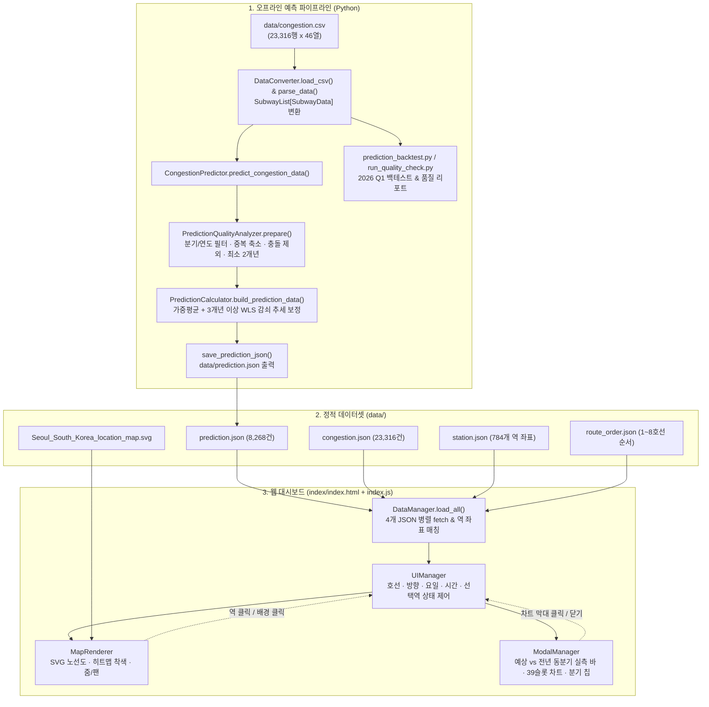
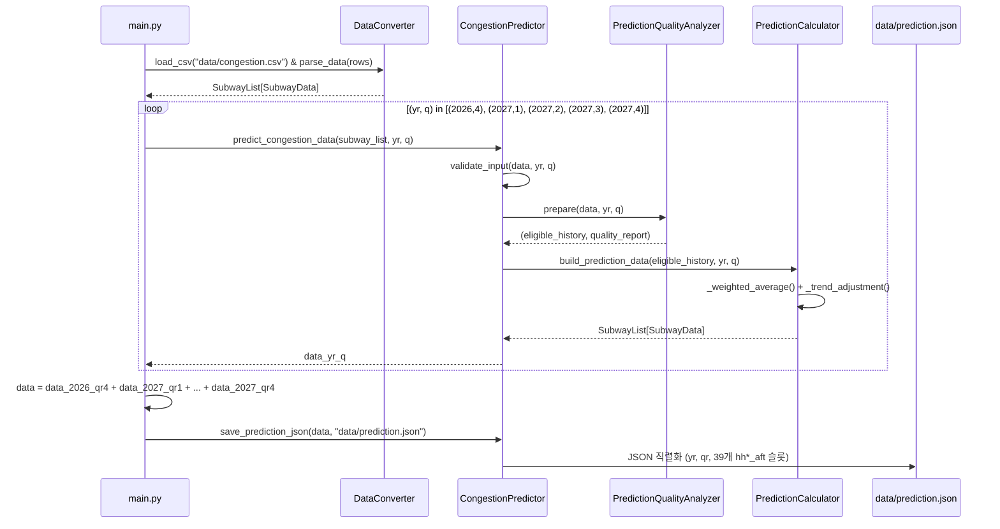
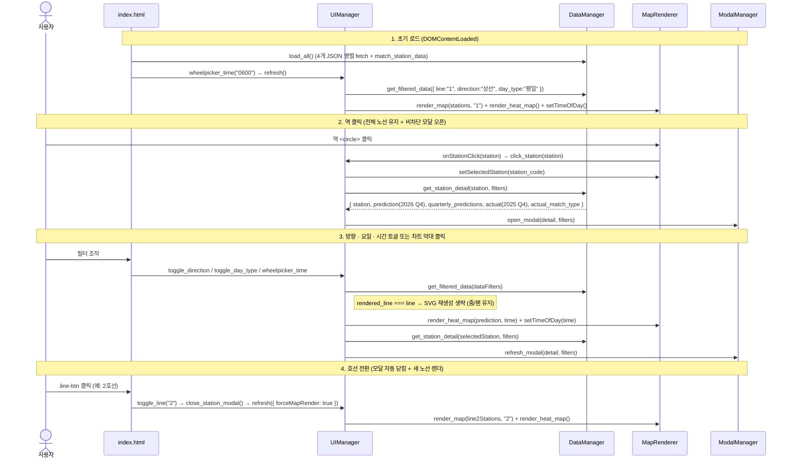

# Subway Congestion Info

서울교통공사 지하철 혼잡도 원천 데이터(`CSV`)를 정제·검증하여 미래 분기별 혼잡도를 예측하는 **오프라인 Python 백엔드 파이프라인**과, 생성된 예측 데이터 및 과거 실측 데이터를 서울 지도 위 SVG 노선도 히트맵과 비차단 역 상세 모달로 시각화하는 **Vanilla HTML/CSS/JS 웹 대시보드** 프로젝트입니다.

> - **예측 범위**: `2026 Q4` + `2027 Q1~Q4` (총 5개 분기, **8,268건**)
> - **백테스트 성능 (`2026 Q1`)**: 비교 프로필 1,641개 / 62,905 슬롯, **MAE `2.2422`** (직전 연도 베이스라인 `2.3855` 대비 개선)
> - **자동화 테스트**: 백엔드 `unittest` **20/20 통과**, 프론트엔드 `node:test` **15/15 통과**

---

## Project Overview

**Subway Congestion Info**는 데이터 전처리·품질 검증·추세 기반 예측을 담당하는 백엔드와, 정적 JSON 자산을 로드해 인터랙티브 노선도 히트맵 및 상세 비교 차트를 제공하는 프론트엔드로 분리된 구조를 가집니다.

### 기술 스택
- **Backend**: Python 3 (표준 라이브러리만 사용 — 외부 패키지 설치 불필요)
- **Frontend**: Vanilla HTML5 / CSS3 / JavaScript (ES6+, SVG 렌더링, 프레임워크 미사용)
- **Testing**: Python `unittest`, Node.js 내장 `node:test`

### 프로젝트 구조

| 계층 | 파일 / 디렉터리 | 주요 역할 |
| --- | --- | --- |
| **백엔드 엔트리** | `main.py` | CSV 로드 → `2026 Q4` + `2027 Q1~Q4` 예측 실행 → `data/prediction.json` 저장 |
| **도메인 / 파싱** | `data_manager.py` | `SubwayData`, `SubwayList`, `DataConverter`(`load_csv`, `parse_data`) |
| **예측 오케스트레이션** | `congestion_predictor.py` | `CongestionPredictor`: 입력 검증, 품질 분석기·계산기 DI, 예측·저장 조율 |
| **품질 필터링** | `prediction_quality.py` | `PredictionQualityAnalyzer`: 분기/연도 필터, 식별자·중복·충돌·최소 이력 검증 |
| **예측 계산 / 직렬화** | `prediction_calculator.py` | `PredictionCalculator`(최근 가중평균 + 감쇠 WLS 추세 보정), `save_prediction_json()` |
| **백테스트 / 리포트** | `prediction_backtest.py`, `run_quality_check.py` | `2026 Q1` 백테스트(MAE vs 직전 연도 베이스라인) 및 품질 리포트 생성 |
| **백엔드 테스트** | `tests/test_*.py` (5개 파일, 20개 테스트) | 예측기, 추세 계산기, 품질 분석, 백테스트, JSON 스키마 계약 검증 |
| **데이터 자산** | `data/*` (6개 데이터 파일 + `data/README.md`) | 원천 CSV/JSON, 예측 JSON, 역 좌표, 노선 정차 순서, 서울 배경 지도 SVG |
| **프론트엔드** | `index/index.html`, `index/index.css`, `index/index.js` | 병렬 JSON 로딩, 좌표 매칭, SVG 노선도·히트맵·줌/팬, 비차단 역 상세 모달 |
| **프론트엔드 테스트** | `index/modal.test.js` (15개 테스트) | 모달 인터랙션, 다중 분기/전년 동분기 매칭, SOLID 구조, 실데이터 통합 검증 |

### End-to-End 시스템 플로우



---

## How to Run

### 사전 요구 사항
- **Python 3.x** (별도 `pip install` 없이 표준 라이브러리만으로 동작)
- **웹 브라우저** (Chrome, Edge, Safari, Firefox 등)
- **Node.js** *(선택 사항 — 프론트엔드 자동화 테스트 실행 시 필요)*

### 1. 예측 데이터 생성 (`data/prediction.json`)
프로젝트 루트에서 `main.py`를 실행하면 `data/congestion.csv`를 파싱해 `2026 Q4` 및 `2027 Q1~Q4` 혼잡도 예측 결과(8,268건)를 `data/prediction.json`으로 생성합니다.

```bash
python3 main.py
```

### 2. 웹 대시보드 실행
프론트엔드는 `fetch()`로 `../data/*.json`과 배경 SVG를 로드하므로, 반드시 **프로젝트 루트에서 로컬 HTTP 서버**를 실행해 접속해야 합니다.

```bash
python3 -m http.server 8000
```

서버 실행 후 브라우저에서 아래 주소로 접속합니다.

```text
http://localhost:8000/index/
```

### 3. 품질 분석 및 백테스트 리포트 생성
`2027 Q1~Q4` 분기별 데이터 품질 리포트와 `2026 Q1` 백테스트 결과(MAE vs 직전 연도 베이스라인)를 `reports/prediction_quality_report.json`에 저장합니다.

```bash
python3 run_quality_check.py
```

### 4. 자동화 테스트 실행

```bash
# 백엔드 테스트 (5개 파일, 20개 테스트)
python3 -m unittest discover -s tests

# 프론트엔드 테스트 (15개 테스트)
node --test index/modal.test.js
```

---

## Data Used

원천 혼잡도 데이터는 **서울교통공사 지하철 혼잡도 정보**([Seoul Data Hub](https://data.seoul.go.kr/bsp/wgs/dataView/data300View/645.do))를 기반으로 하며, 상세 컬럼 명세와 고유값 목록은 [`data/README.md`](./data/README.md)에 정리되어 있습니다.

### 데이터셋 파일 구성 (`data/`)

| 파일 | 크기 | 규모 | 주요 키 / 구조 | 역할 |
| --- | --- | --- | --- | --- |
| `data/congestion.csv` | 5.00 MB | 23,316행 x 46열 | `yr`, `day`, `lnno`, `sttn_no`, `sttn_nm`, `drc`, 39슬롯, `qu` | 백엔드 예측 파이프라인의 원천 입력 (상단 2줄 헤더) |
| `data/congestion.json` | 24.16 MB | 23,316건 | `Array<Object>` (`hh*_aft`, 분기 키 `qu`) | 프론트엔드 모달의 **전년도 동분기 실측(`2025 Q4`)** 비교 데이터 |
| `data/prediction.json` | 8.9 MB | 8,268건 | `Array<Object>` (`hh*_aft`, 분기 키 `qr`) | `main.py` 산출 예측 데이터 (`2026 Q4` 1,647건 + `2027 Q1~Q4` 6,621건) |
| `data/station.json` | 77.3 KB | 784건 | `{ DESCRIPTION, DATA }` (`bldn_id`, `bldn_nm`, `route`, `lat`, `lot`) | 역별 위경도 좌표 (SVG 지도 투영 기준) |
| `data/route_order.json` | 2.7 KB | 8개 노선 | `"1"`~`"8"` → `main`, `seongsu_branch`, `sinjeong_branch`, `banghwa_branch`, `maecheon_branch`, `hanam_branch` | 1~8호선 본선 및 지선 폴리라인 정차 순서 |
| `data/Seoul_South_Korea_location_map.svg` | 262.1 KB | 1개 SVG | viewBox `0 0 970 690` | 서울 배경 지도 벡터 이미지 |

### 39개 시간대 슬롯 매핑 계약
백엔드(`CONGESTION_TIME_KEYS`)와 프론트엔드(`OPERATING_TIME_SLOTS`)가 동일한 운행 순서의 39개 30분 단위 슬롯을 공유합니다.
- **CSV 헤더 (열 인덱스 `6..44`)**: `5:30~ (%)`, `6:00~ (%)`, ..., `23:30~ (%)`, `24:00~ (%)`, `24:30~ (%)`
- **JSON 필드 키**: `hh05_mm30_aft`, `hh06_aft`, ..., `hh23_mm30_aft`, `hh00_aft`, `hh00_mm30_aft`
- **프론트엔드 시간 코드**: `"0530"`, `"0600"`, ..., `"2330"`, `"0000"`, `"0030"` (`timeSlotToKey()`로 변환)

### 원천 데이터 특성 및 전처리 규칙
- **연도·분기 분포**: `2017, 2019, 2021, 2022, 2023`년(8,352행)은 분기(`qu`)가 `"-"`(`None`)인 연단위 데이터로, 분기 예측 및 동분기 실측 매칭에서 자동 제외됩니다. 분기 이력이 존재하는 `2024 Q1~Q4`, `2025 Q1~Q4`, `2026 Q1`을 학습에 사용합니다 (`2027 Q1`은 3개년, `Q2~Q4`는 2개년 이력 활용).
- **비정규 값 및 지선 매핑**:
  - `lnno` 공백 108행은 `None`으로 파싱 후 식별자 검증에서 제외됩니다.
  - 지선 호선 코드 `13`(2호선 성수지선), `14`(2호선 신정지선), `15`(5호선 마천지선) 및 진접선(`405`, `406`, `408`)은 프론트엔드 `LINE_ROUTE_RULES`로 일관되게 매핑됩니다.
  - 방향(`drc`)은 2호선 `내선`/`외선`, 그 외 호선은 `상선`/`하선`을 사용하며 UI에서 자동 대응됩니다.
- **예측-실측 정합성**: `2026 Q4` 예측 프로필 1,647건 전원이 `data/congestion.json`의 `2025 Q4` 실측 데이터와 100% 매칭(누락 0건)됩니다.

---

## Class Design and Object Interactions

백엔드와 프론트엔드 모두 **단일 책임 원칙(SRP), 개방-폐쇄 원칙(OCP), 리스코프 치환 원칙(LSP), 의존성 역전 원칙(DIP)**을 고려하여 클래스를 설계했습니다.

### 1. Backend (Python) 클래스 설계

| 모듈 | 클래스 / 함수 | 주요 책임 및 설계 특징 |
| --- | --- | --- |
| `data_manager.py` | `SubwayData`, `SubwayList`, `DataConverter` | CSV(`utf-8-sig`) 파싱 및 도메인 모델 캡슐화. `SubwayList.__add__`는 원본을 변경하지 않는 비파괴적 병합을 제공 |
| `congestion_predictor.py` | `CongestionPredictor` | 입력 검증(`validate_input`), 이력 선별, 예측 계산, JSON 저장을 조율하는 오케스트레이터. 생성자에서 `calculator`와 `quality_analyzer`를 주입받아 교체 가능(OCP/DI) |
| `prediction_quality.py` | `PredictionQualityAnalyzer` | 4단계 이력 선별(`prepare`): ① 목표 분기·과거 연도 필터 → ② 식별자 유효성 검사 → ③ 동일 `(프로필, 연도)` 내 완전 중복 1건 축소 및 값/역명 충돌 그룹 제외 → ④ 최소 연도 수(`minimum_years=2`) 및 전체 결측 프로필 제외 후 품질 리포트 생성 |
| `prediction_calculator.py` | `PredictionCalculator`, `save_prediction_json` | 39개 슬롯별 독립 계산(결측 `None` 보존): ① 선형 연도 가중평균(`_weighted_average`, `weight = year - earliest_year + 1`) ② 유효 연도 3개년 이상일 때 가중 최소제곱(WLS) 기반 감쇠 선형 추세 보정(`_trend_adjustment`, 관측 범위의 `±25%` 클램핑) ③ 비음수 보정 및 소수점 둘째 자리 반올림 |
| `prediction_backtest.py` | `run_backtest()` | 목표 분기(`2026 Q1`)를 제외한 과거 이력만으로 예측 후 유일 실측치(`_unique_actuals`)와 동일 유효 슬롯 MAE 비교 |

#### 백엔드 객체 협력 시퀀스 (`main.py`)



### 2. Frontend (JavaScript) 클래스 설계 (`index/index.js`)

| 계층 | 클래스 | 주요 책임 및 SOLID 설계 |
| --- | --- | --- |
| **혼잡도 분류기** | `CongestionGradeClassifier` | 임계치 테이블(`20 / 40 / 70 / ∞`) 기반 4단계 등급·색상 및 결측(`#64748b`) 판별. `MapRenderer`와 `ModalManager`에 생성자 주입(OCP·DIP) |
| **데이터 계층** | `Data` → `SubwayRecordData` → `CongestionData`, `PredictionData` / `Data` → `StationData` | `Data`는 `fetcher` 주입(DI), `allowMissing`, 공통 `get_filtered_data()`(LSP) 제공. `SubwayRecordData`가 공통 7종 필터·시간 키 변환을 통합. `PredictionData`는 현재 연도·분기(`2026 Q4`) 우선 선택, `CongestionData.find_baseline_record()`는 3단계 동분기 실측 매칭 수행 |
| **데이터 조율** | `DataManager` | 생성자 DI(`paths`, `dependencies`) 지원. `load_all()`로 4개 JSON 병렬 로드, `match_station_data()`로 `LINE_ROUTE_RULES` 기반 ID 우선·역명 보조 좌표 매칭, `get_filtered_data()` 및 `get_station_detail()` 제공 |
| **지도 렌더러** | `MapRenderer` | 위경도→`970x690` SVG 투영, 노선 `<polyline>`·역 `<circle>`·라벨 렌더링, 휠 줌(1~5배)·드래그 팬·배경 클릭 감지, 히트맵 착색(`render_heat_map`), 시간대 배경(`setTimeOfDay`), 선택 역 강조(`setSelectedStation`) |
| **모달 매니저** | `ModalManager` | 비차단 플로팅 상세 카드 제어(`open_modal`, `refresh_modal`, `close_modal`). 예상 vs 전년 동분기 실측 비교 바, 39슬롯 미니 막대 차트, 다중 분기 칩(`26 Q4`~`27 Q4`) 렌더링 및 `×`/ESC 닫기 동기화 |
| **UI 컨트롤러** | `UIManager` | `line`, `direction`, `day_type`, `time`, `quarter`, `selected_station_code`, `rendered_line` 중앙 상태 관리. 지도 필터와 선택 역 상태를 분리해 역 클릭 시 전체 노선을 유지하고, 호선 변경 시에만 SVG를 재생성 |

#### 프론트엔드 객체 협력 시퀀스



---

## Dashboard Features

### 1. 3단 레이아웃 및 다중 조건 필터링
- **상단 요약 바 (`.selection-info`)**: 현재 선택된 `호선 · 방향 · 요일 · 시간`을 실시간 표시 (2호선 선택 시 `상선`/`하선`을 자동으로 `내선`/`외선`으로 표기).
- **좌측 호선 선택 패널 (`.line-selector`)**: 서울 지하철 **1~8호선** 원클릭 전환 (지선 포함).
- **우측 조건 제어 패널 (`.right-panel`)**:
  - **방향 토글**: 상선(내선) / 하선(외선)
  - **요일 토글**: 평일 / 토요일 / 일요일
  - **시간 휠피커**: 운행 시간대 39개 슬롯(`05:30` ~ `00:30`)을 클릭 또는 마우스 휠 스크롤로 순환 선택.

### 2. 인터랙티브 SVG 노선도 및 히트맵
- **서울 지도 위 노선·역 시각화**: `Seoul_South_Korea_location_map.svg` 배경(`970x690`) 위에 위경도 투영된 역 노드와 본선/지선 폴리라인을 렌더링합니다.
- **줌/팬 유지 최적화**: 마우스 휠 줌(1~5배)과 드래그 팬을 지원하며, 호선 변경 시에만 SVG를 재생성하고 방향·요일·시간 변경 시에는 히트맵 색상과 시간대 배경 분위기(`setTimeOfDay`)만 갱신해 사용자가 확대해 둔 시점을 유지합니다.
- **통일된 4단계 혼잡도 색상 체계** *(지도 역 노드 · 하단 범례 · 모달 배지 · 비교 바 · 39슬롯 차트 100% 일관 적용)*:

| 등급 | 혼잡도 구간 | 색상 코드 |
| --- | --- | --- |
| **원활** | `< 20%` | `#58d68d` (초록) |
| **보통** | `20% ~ 39.9%` | `#f4d03f` (노랑) |
| **혼잡** | `40% ~ 69.9%` | `#f1948a` (분홍) |
| **매우 혼잡** | `>= 70%` | `#ff3030` (빨강) |
| **데이터 없음** | 결측 (`null` / `""` / `NaN`) | `#64748b` (회색) |

### 3. 비차단 플로팅 역 상세 모달 (`ModalManager`)
역을 클릭하면 화면을 가리지 않는 좌하단 플로팅 카드(모바일 환경에서는 하단 시트)가 열리며, 모달이 열린 상태에서도 **지도 팬/줌·타 역 클릭·방향/요일/시간 전환**을 자유롭게 수행할 수 있습니다.
- **실시간 동기화 & 직관적 닫기**: 외부 필터를 변경하면 열린 모달의 수치와 차트가 즉시 갱신되며, `×` 버튼·`ESC` 키·지도 빈 영역 클릭·호선 전환 시 자연스럽게 닫힙니다.
- **예상 혼잡도 vs 전년도 동분기 실측 비교 바**:
  - 현재 연도·분기(`2026 Q4`) 예측값을 우선 표시하고, 과거 실측 데이터에서 **1순위 전년 동분기(`2025 Q4`) → 2순위 과거 동분기 최신 → 3순위 없음(타 분기 및 연단위 데이터 차단)** 규칙으로 비교군을 매칭해 증감폭(`%p`)을 함께 제공합니다.
- **39슬롯 시간대 미니 막대 차트**:
  - 하루 전체 운행 시간대(`05:30`~`00:30`) 혼잡도 추이와 피크/최소 혼잡 시간을 한눈에 확인하고, 차트 막대를 클릭해 대시보드 전체 기준 시간을 해당 슬롯으로 즉시 이동할 수 있습니다.
- **다중 분기 비교 칩 (`26 Q4` ~ `27 Q4`)**:
  - 선택된 역·시간대의 향후 5개 분기별 예상 혼잡도를 연도 구분 칩으로 비교할 수 있습니다.
